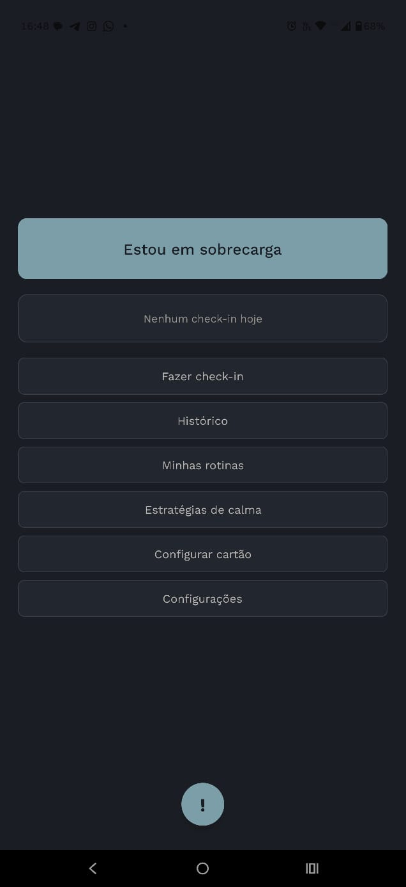
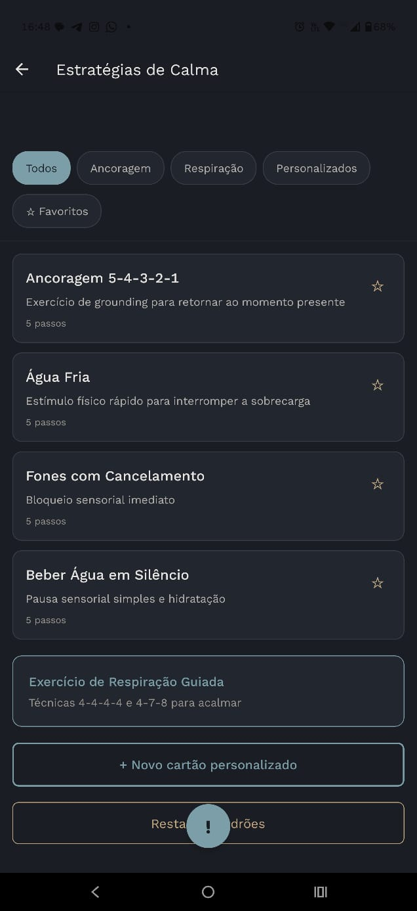

# TEA Autonomia

**Rotinas, comunicação de apoio e estratégias de regulação no seu ritmo.**

`React Native · Expo · TypeScript`

[Reportar problema](https://github.com/alunoadsnoite/tea-mvp/issues) · [Licença](LICENSE)

## Veja o aplicativo




Aplicativo móvel para adultos no Espectro Autista (TEA) focado em **autonomia, previsibilidade e gerenciamento de sobrecarga sensorial e crises**.

## Versão 1.0.19

Use **Configurações → Idioma** para escolher **Português (Brasil)**, **English**, **Español** ou **Français**. A escolha fica no aparelho, funciona offline e preserva os textos personalizados. O widget Android usa o idioma do sistema.

Acompanhe a versão no [GitHub](https://github.com/alunoadsnoite/tea-mvp/releases/tag/v1.0.19) e a disponibilidade no [F-Droid](https://f-droid.org/packages/com.teamvp.app/).

[Histórico completo de versões](CHANGELOG.md).

## Privacidade

O TEA Autonomia guarda check-ins, rotinas, cartões, contatos de apoio e preferências no aparelho. O desenvolvedor não recebe esses registros pelo app. O app solicita ao Android que exclua seus dados de backups e de transferências entre aparelhos.

Use o Histórico de Check-ins e as configurações do Cartão de Crise para apagar registros. Para apagar todos os dados locais, limpe o armazenamento do app nas configurações do Android. Ao escolher uma ação no cartão, o número e, no caso do SMS, o texto são repassados ao aplicativo de telefone ou mensagens. Você decide se quer ligar ou enviar.

Dúvidas sobre privacidade podem ser enviadas para valdenorsa@proton.me.

## Melhorias locais em validação
- Veja o [roteiro de validação e publicação da atualização de idiomas](docs/PUBLICAR_IDIOMAS.md).

- Rotinas em andamento oferecem Continuar e preservam passo, pausa e tempo. Iniciar outra rotina pede confirmação.
- A Home permite rolagem; o histórico fica no check-in e a edição do cartão fica em Configurações.
- Preferências locais: vibração (desligada por padrão), redução de movimento e prévia opcional Agora / Depois.
- Redução de movimento respeita também o sistema, mantém o círculo de respiração estático e atualiza o timer sem interpolação contínua.
- Texto acompanha a escala de acessibilidade do sistema sem limite artificial de 130%.
- Mensagens do cartão podem ser ocultadas individualmente, inclusive as padrão; contatos continuam disponíveis se todas forem ocultadas.
- Novas instalações usam mensagens sem afirmar ausência de perigo ou condição de fala. Textos já salvos são preservados; podem ser editados nas configurações.

## Principais Funcionalidades

### 1. Cartão de Comunicação de Crise
- Acesso instantâneo em 1 toque na Home ou pelo botão flutuante
- Mensagens pré-configuradas personalizáveis
- Contatos de emergência (ligar/mensagem)
- Funcionalidade 100% offline
- Modo cheio e alto contraste

### 2. Check-in de Bateria Social & Interocepção
- Registro rápido (menos de 10 segundos)
- Bateria Social (0-100%)
- Carga Sensorial (0-5)
- Energia Física (0-5)
- Gatilhos rápidos selecionáveis
- Sugestões automáticas de regulação
- Histórico dos últimos 7 dias com resumo da carga sensorial e dos três gatilhos mais registrados
- Acesso aos cartões de regulação e favoritos pelas sugestões do check-in

### 3. Rotinas Visuais Sequenciais
- Execução passo-a-passo (uma tarefa por vez)
- Timer visual suave (sem números estressantes)
- Rotinas pré-configuráveis e personalizáveis
- Pausa real (o timer congela) e extensão de tempo sem penalidade

### 4. Central de Cartões de Regulação (Coping Cards)
- Exercício de Ancoragem 5-4-3-2-1
- Respiração Guiada (4-4-4-4 e 4-7-8)
- Cartões personalizados com criação e edição
- Exclusão de cartões personalizados
- Favoritos e categorias

## Stack Tecnológica

- **Frontend**: React Native + Expo SDK 50 + TypeScript
- **Estilização**: `StyleSheet` do React Native
- **Estado**: Zustand + AsyncStorage (offline-first)
- **Navegação**: Expo Router
- **Build**: EAS Build / Gradle

## Instalação

```bash
# Instalar dependências
npm install

# Validar código
npm run lint
npm run typecheck
npm test

# Iniciar em modo desenvolvimento
npx expo start

# Build Android (APK)
npx eas build -p android --profile preview

# Validar o bundle de todas as rotas (sem precisar de pasta nativa)
npx expo export --platform android

# Build local — exige gerar a pasta nativa primeiro
npx expo prebuild -p android

# Atenção: JDK 17 é obrigatório. O AGP 8.1.1 do SDK 50 falha com JDK 21.
JAVA_HOME=/caminho/para/jdk17 ./android/gradlew assembleRelease
```

Use `assembleRelease` para instalar no celular. O APK **debug** não embute o
bundle JS e depende do Metro rodando em `localhost:8081` — instalado sozinho,
abre uma tela de erro.

O projeto usa Expo com geração do projeto nativo. Apenas `android/app/build.gradle` é rastreado nessa pasta para os metadados de versão do F-Droid; ele não constitui um projeto Android completo. Para compilar localmente, gere os demais arquivos com `npx expo prebuild -p android`.

O widget de acesso rápido ao Cartão de Crise está **implementado no Android**
(um toque abre `/crisis-card`) e **não implementado no iOS** — ver
[WIDGET_SETUP.md](WIDGET_SETUP.md). Sem o widget, o Cartão de Crise continua
acessível pelo botão flutuante e pelo card da Home.

## Estrutura do Projeto

```
src/
├── app/                    # Telas (Expo Router)
│   ├── _layout.tsx         # Layout raiz + FAB
│   ├── index.tsx           # Home
│   ├── crisis-card.tsx     # Cartão de Crise
│   ├── crisis-settings.tsx # Configurações do Cartão
│   ├── interception.tsx    # Check-in
│   ├── checkin-history.tsx # Histórico
│   ├── routines.tsx        # Lista de Rotinas
│   ├── routines/new.tsx    # Criação/edição de Rotina
│   ├── routine-execution.tsx # Execução
│   ├── regulation.tsx      # Cartões de Regulação
│   ├── breathing-guide.tsx # Respiração Guiada
│   ├── settings.tsx        # Configurações do App
│   └── coping-card/        # Detalhe e criação/edição do Cartão
├── components/             # Componentes reutilizáveis (inclui RouteErrorBoundary)
├── hooks/                  # Custom hooks
├── lib/                    # Utilitários
├── stores/                 # Stores Zustand
├── types/                  # Schemas TypeScript
└── constants/              # Constantes
```

## Princípios de UX Neurodivergente

- **Tema claro/escuro persistente**: Escolha entre escuro, claro e automático; reduz fadiga visual no escuro
- **Baixa carga cognitiva**: Uma ação principal por tela
- **Sem cores agressivas**: Paleta pastel suave
- **Sem animações piscantes**: Apenas transições suaves
- **Sem alertas vermelhos**: Notificações discretas
- **Tipografia legível**: Contraste WCAG AA
- **Espaçamento generoso**: Respiro visual
- **Rotação automática**: App gira quando o celular gira

## Licença

GPL-3.0 — ver [LICENSE](LICENSE).

## Como contribuir

Sugestões, traduções e relatos de problemas são bem-vindos. Abra uma issue com o contexto e o comportamento esperado. Para alterações de código, explique a mudança e os testes realizados no pull request. Use dados fictícios nos exemplos e nas capturas.
